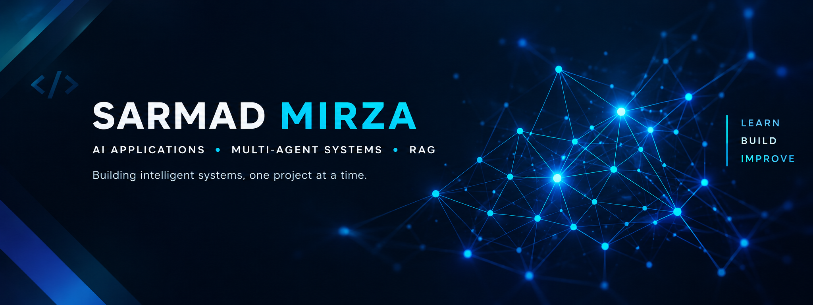

  

---

# Hi, I'm Sarmad Mirza 👋

### Software Engineering Student | AI Applications | Multi-Agent Systems & RAG

I build practical software projects while exploring AI-powered applications, retrieval-augmented generation (RAG), natural language processing, and backend development.

## Featured Projects

- **[CV Analyzer Agent](https://github.com/sarmadmirza8888/cv-analyzer-agent)** — Built an Agent which primarily works on CV data for a Company. Extracts information related to CV and answers using an LLM.
- **[URL RAG Assistant](https://github.com/sarmadmirza8888/url-rag-assistant)** — Building a URL-based retrieval and question-answering assistant with a focus on safe URL handling.
- **[Resume Skill NER](https://github.com/sarmadmirza8888/resume-skill-ner-spacy)** — Extracting skills from resumes using NLP and spaCy. Trained an LLM model and then fine tuned it.
- **[Cyber Network Attack Simulator](https://github.com/sarmadmirza8888/cyber-network-attack-simulator)** — Exploring data structures, algorithms, and cybersecurity concepts with Java.
- **[Skill Swap](https://github.com/sarmadmirza8888/skill-swap)** — A react based project for connecting people who want to exchange skills.

##  Technologies & Interests

**Programming:** Python · Java · JavaScript · SQL

**AI & NLP:** AI Agents · RAG · LangChain · LangGraph · spaCy · Embeddings · FAISS  

**Web & Backend:** HTML · CSS · React · FastAPI

**Databases & Tools:** MySQL · MongoDB · Git · GitHub · Linux · Kaggle · PostGreSql ·DataBricks

##  Currently Focusing On

- Building multi-agent AI applications
- Learning agent orchestration and tool calling
- Developing RAG-based applications
- Improving backend development and API security
- Strengthening software engineering fundamentals

---

 **Explore my repositories:** [github.com/sarmadmirza8888](https://github.com/sarmadmirza8888?tab=repositories)
